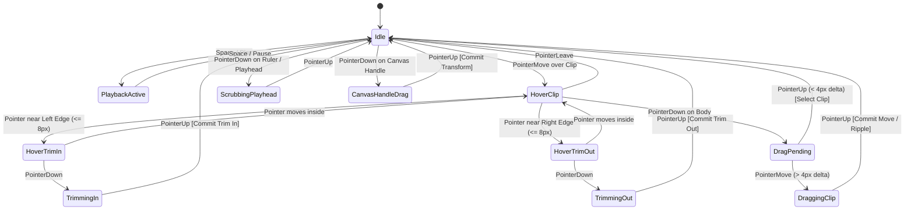

# CapCut Editor Behavioral Mechanics, Physics & Interaction Specification
*Authoritative Technical Architecture and Reverse-Engineered Engineering Specification for Web & Desktop Video Editing Engines*

---

## Executive Summary & System Overview

This specification formalizes the behavioral mechanics, mathematical models, kinematic physics, and interaction architectures reverse-engineered from **CapCut (Desktop & Web versions)**. It establishes the normative requirements for building a professional-grade, high-performance web/desktop non-linear video editing (NLE) engine.

### Key Architectural Pillars
1. **Multi-Space Coordinate System**: Rigorous affine transforms bridging Timeline Discrete Time, Viewport Pixel Space, Normalized Device Coordinates (NDC), and Source Media Frame Times.
2. **Magnetic Snapping Engine with Hysteresis**: A multi-target, weighted potential-well model with break-force resistance to eliminate jitter.
3. **Dual-Track Paradigm (Magnetic Main vs Free PIP/Overlay)**: Asymmetric ripple physics separating Track 0 (Primary Storyline) from upper overlay and lower audio tracks.
4. **Cubic Bézier Velocity Profiles**: Time-remapping calculus solving continuous velocity integrals and audio pitch-locked time stretching (WSOLA).
5. **Direct Viewport Canvas Manipulation**: Rotated 8-point bounding boxes, pivot-anchored affine transformations, and dynamic cursor mapping.
6. **Platform-Accurate Safe Zones & Typography**: Exact geometry profiles for TikTok, Instagram Reels, YouTube Shorts, and SMPTE broadcast standards.

---

## 1. Frame of Reference & Coordinate Spaces

An NLE operates simultaneously across five distinct coordinate systems. Correct spatial and temporal transformations require deterministic mappings between these spaces.

```
+-------------------------------------------------------------------------+
|                        1. Source Media Time Space                       |
|                       t_src in [0, AssetDuration]                       |
+-------------------------------------------------------------------------+
                                    |  (Speed curve v(t), sourceStart)
                                    v
+-------------------------------------------------------------------------+
|                       2. Project Timeline Space                         |
|             Continuous Time t in [0, inf) | Discrete Frames f           |
+-------------------------------------------------------------------------+
            |                                               |
            | (PPS zoom, scrollLeft)                         | (Layer transform M)
            v                                               v
+--------------------------------------+   +------------------------------+
|     3. Timeline Viewport Pixels      |   |   4. Canvas Render Space     |
|   x_px = t * PPS - scrollLeft        |   |   W_comp x H_comp (e.g. 1080) |
+--------------------------------------+   +------------------------------+
            |                                               |
            | (DOM getBoundingClientRect)                   | (Viewport fit scale)
            v                                               v
+-------------------------------------------------------------------------+
|                     5. Screen / Window Pointer Events                   |
|                             (clientX, clientY)                          |
+-------------------------------------------------------------------------+
```

### 1.1 Mathematical Formulations of Coordinate Spaces

#### A. Project Timeline Continuous vs Discrete Space
Let $t \in \mathbb{R}_{\ge 0}$ be continuous timeline time in seconds.
Let $\text{FPS} \in \{24, 25, 30, 50, 60\}$ be the project frame rate.
The discrete frame index $f \in \mathbb{N}_0$ and quantised timeline time $t_{\text{quantized}}$ are defined by:
$$f = \lfloor t \cdot \text{FPS} + 0.5 \rfloor$$
$$t_{\text{quantized}} = \frac{f}{\text{FPS}} = \frac{\lfloor t \cdot \text{FPS} + 0.5 \rfloor}{\text{FPS}}$$

#### B. Timeline Viewport Pixel Mapping
Let $\text{PPS}$ (Pixels Per Second) be the timeline horizontal zoom scale ($8 \le \text{PPS} \le 200$).
Let $x_{\text{scroll}}$ be the horizontal scroll offset in pixels (`scroller.scrollLeft`).
The mapping between timeline time $t$ and viewport pixel coordinate $x_{\text{px}}$ is:
$$x_{\text{px}}(t) = t \cdot \text{PPS} - x_{\text{scroll}}$$
$$t(x_{\text{px}}) = \frac{x_{\text{px}} + x_{\text{scroll}}}{\text{PPS}}$$

#### C. Canvas Affine Transformation Matrix
Every visual clip (video, image, text, sticker) is positioned on the canvas via a $3 \times 3$ homogeneous affine transformation matrix $M \in \mathbb{R}^{3 \times 3}$:

$$M = T(t_x, t_y) \cdot R(\theta) \cdot S(s_x, s_y) \cdot T(-p_x, -p_y)$$

Where:
- $T(t_x, t_y) = \begin{bmatrix} 1 & 0 & t_x \\ 0 & 1 & t_y \\ 0 & 0 & 1 \end{bmatrix}$ (Translation in composition canvas pixels)
- $R(\theta) = \begin{bmatrix} \cos\theta & -\sin\theta & 0 \\ \sin\theta & \cos\theta & 0 \\ 0 & 0 & 1 \end{bmatrix}$ (Rotation by angle $\theta \in [0, 2\pi)$)
- $S(s_x, s_y) = \begin{bmatrix} s_x & 0 & 0 \\ 0 & s_y & 0 \\ 0 & 0 & 1 \end{bmatrix}$ (Scale factors)
- $T(-p_x, -p_y)$ is the translation centering the pivot point (default $p = (\frac{W_{\text{clip}}}{2}, \frac{H_{\text{clip}}}{2})$)

Expanding the composite matrix:
$$M = \begin{bmatrix} s_x \cos\theta & -s_y \sin\theta & t_x - p_x s_x \cos\theta + p_y s_y \sin\theta \\ s_x \sin\theta & s_y \cos\theta & t_y - p_x s_x \sin\theta - p_y s_y \cos\theta \\ 0 & 0 & 1 \end{bmatrix}$$

---

## 2. Timeline Trimming & Ripple Dynamics

CapCut’s timeline distinguishes between **Track 0 (The Magnetic Primary Storyline)** and **Track $1 \dots N$ (Overlay, PIP, Audio, Text Lanes)**.

### 2.1 Track Hierarchy & Structural Rules

```
+------------------------------------------------------------------------------------+
| Track 3 [Text/Captions] : Free placement, magnetic snap to playhead/cuts           |
+------------------------------------------------------------------------------------+
| Track 2 [Overlay/PIP]   : Free placement, collision auto-layering                  |
+------------------------------------------------------------------------------------+
| Track 0 [Main Storyline]: MAGNETIC RIPPLE - No zero-length gaps, automatic closure |
+------------------------------------------------------------------------------------+
| Track -1 [Audio Track]  : Pinned to Main Track or free music/SFX                   |
+------------------------------------------------------------------------------------+
```

1. **Track 0 (Primary Storyline)**:
   - **Gap Invariant**: Under default magnetic mode, no empty gaps exist between clips. For any clip $C_i$ followed by $C_{i+1}$:
     $$C_{i+1}.\text{startTime} \equiv C_i.\text{startTime} + C_i.\text{duration}$$
   - **Ripple Invariant**: Any modification to $C_i$ changing its duration by $\Delta d$ propagates an immediate temporal shift to all subsequent clips:
     $$\forall k > i: \quad C_k.\text{startTime} \leftarrow C_k.\text{startTime} + \Delta d$$
   - **Clip Deletion**: Deleting $C_i$ causes all downstream clips to shift left by $C_i.\text{duration}$.
2. **Tracks $1 \dots N$ (Secondary Overlays & Audio)**:
   - Clips allow free temporal placement unless **Ripple Edit Mode** is explicitly toggled ON.
   - Pinned clips maintain a relative offset $\delta t_{\text{pin}} = C_{\text{sec}}.\text{startTime} - C_{\text{main}}.\text{startTime}$. When $C_{\text{main}}$ moves or ripples, $C_{\text{sec}}.\text{startTime} \leftarrow C_{\text{main}}.\text{startTime} + \delta t_{\text{pin}}$.

---

### 2.2 Trimming Mechanics & Constraints

#### A. Left Edge Trim (In-Point Trimming)
Left trimming alters the clip's in-point while keeping the clip's timeline out-point ($t_{\text{out}} = \text{startTime} + \text{duration}$) stationary.

```
Initial State:
[--------- Source Media Buffer ---------------------------------]
          ^ sourceStart                       ^ sourceEnd
          [============== Timeline Clip ==================]
          ^ startTime                         ^ startTime + duration

Drag Left Handle by delta:
                 ^ new sourceStart
                 [======= Truncated Clip ========]
                 ^ new startTime             ^ stationary out-point
```

Let $\Delta t$ be the proposed pointer temporal displacement.
Constraints:
1. Minimum clip duration: $d_{\text{min}} = \max\left(\frac{1}{\text{FPS}}, 0.1\text{s}\right)$ (typically 3 frames).
2. Maximum extension: Bounded by available source media headroom prior to `sourceStart`:
   $$\Delta t_{\text{max\_headroom}} = -\frac{\text{sourceStart}}{\text{speed}}$$

Formulas:
$$t_{\text{start\_proposed}} = \text{startTime} + \Delta t$$
$$t_{\text{start\_clamped}} = \text{clamp}\left(t_{\text{start\_proposed}}, \, \text{startTime} - \frac{\text{sourceStart}}{\text{speed}}, \, (\text{startTime} + \text{duration}) - d_{\text{min}}\right)$$
$$\Delta t_{\text{actual}} = t_{\text{start\_clamped}} - \text{startTime}$$
$$\text{startTime}_{\text{new}} = t_{\text{start\_clamped}}$$
$$\text{duration}_{\text{new}} = \text{duration} - \Delta t_{\text{actual}}$$
$$\text{sourceStart}_{\text{new}} = \text{sourceStart} + \Delta t_{\text{actual}} \cdot \text{speed}$$

#### B. Right Edge Trim (Out-Point Trimming)
Right trimming modifies the clip's duration and out-point while keeping `startTime` and `sourceStart` invariant.
Let $d_{\text{asset}}$ be the total duration of the underlying media file.
Constraints:
1. Minimum clip duration: $d_{\text{min}}$.
2. Maximum extension: Bounded by remaining source media tailroom:
   $$\text{tailroom} = \frac{d_{\text{asset}} - \text{sourceEnd}}{\text{speed}}$$

Formulas:
$$t_{\text{end\_proposed}} = (\text{startTime} + \text{duration}) + \Delta t$$
$$t_{\text{end\_clamped}} = \text{clamp}\left(t_{\text{end\_proposed}}, \, \text{startTime} + d_{\text{min}}, \, \text{startTime} + \frac{d_{\text{asset}} - \text{sourceStart}}{\text{speed}}\right)$$
$$\text{duration}_{\text{new}} = t_{\text{end\_clamped}} - \text{startTime}$$
$$\text{sourceEnd}_{\text{new}} = \text{sourceStart} + \text{duration}_{\text{new}} \cdot \text{speed}$$

#### C. Slip Editing
A Slip Edit shifts the media content visible within the clip window without altering the clip's `startTime` or `duration` on the timeline.
$$\Delta t_{\text{slip\_clamped}} = \text{clamp}\left(\Delta t_{\text{slip}}, \, -\frac{\text{sourceStart}}{\text{speed}}, \, \frac{d_{\text{asset}} - \text{sourceEnd}}{\text{speed}}\right)$$
$$\text{sourceStart}_{\text{new}} = \text{sourceStart} + \Delta t_{\text{slip\_clamped}} \cdot \text{speed}$$
$$\text{sourceEnd}_{\text{new}} = \text{sourceEnd} + \Delta t_{\text{slip\_clamped}} \cdot \text{speed}$$

#### D. Dual-Roller (Rolling) Trim
When trimming the boundary between two adjacent touching clips $C_1$ and $C_2$:
$$\Delta t_{\text{roll\_max}} = \min\left(\frac{d_{\text{asset}, 1} - C_1.\text{sourceEnd}}{C_1.\text{speed}}, \, C_2.\text{duration} - d_{\text{min}}\right)$$
$$\Delta t_{\text{roll\_min}} = -\min\left(C_1.\text{duration} - d_{\text{min}}, \, \frac{C_2.\text{sourceStart}}{C_2.\text{speed}}\right)$$
$$\Delta t = \text{clamp}(\Delta t_{\text{input}}, \Delta t_{\text{roll\_min}}, \Delta t_{\text{roll\_max}})$$
$$C_1.\text{duration} \leftarrow C_1.\text{duration} + \Delta t$$
$$C_1.\text{sourceEnd} \leftarrow C_1.\text{sourceEnd} + \Delta t \cdot C_1.\text{speed}$$
$$C_2.\text{startTime} \leftarrow C_2.\text{startTime} + \Delta t$$
$$C_2.\text{duration} \leftarrow C_2.\text{duration} - \Delta t$$
$$C_2.\text{sourceStart} \leftarrow C_2.\text{sourceStart} + \Delta t \cdot C_2.\text{speed}$$

---

### 2.3 Drag Thresholds & Hysteresis Deadzones

To avoid accidental edits when the user clicks to select a clip or scrub, CapCut employs a **Pointer Drag Deadzone**:
- **Pixel Deadzone Threshold**: $r_{\text{deadzone}} = 4.0\text{px}$.
- The system remains in `HOVER` / `PENDING_SELECT` state until:
  $$\Delta r = \sqrt{(x_{\text{current}} - x_{\text{down}})^2 + (y_{\text{current}} - y_{\text{down}})^2} > r_{\text{deadzone}}$$
- Once $\Delta r > r_{\text{deadzone}}$, pointer capture is acquired (`setPointerCapture`), the interaction state transitions to `DRAGGING` or `TRIMMING`, and the initial displacement is factored into the delta calculation to prevent sudden jumps.

---

## 3. Magnetic Snapping & Alignment Physics

CapCut’s magnetic snapping feels tactile and responsive due to its **Potential Well Potential Energy Model** coupled with **Snap Breaking Resistance (Hysteresis)**.

### 3.1 Snap Targets & Hierarchy Scoring

When a clip boundary or playhead moves to time $t$, the snapping engine searches for candidate targets within a pixel radius $R_{\text{snap}} = 10\text{px}$ (converted to time $\delta_{\text{snap}} = \frac{R_{\text{snap}}}{\text{PPS}}$).

```
Candidate Snap Targets:
1. Current Playhead Position [t_playhead]       (Weight w = 1.00)
2. In/Out Edges of Adjacent Clips on Same Track (Weight w = 0.95)
3. In/Out Edges of Clips on Other Tracks        (Weight w = 0.85)
4. Audio Beat Markers / Speech Word Intervals   (Weight w = 0.80)
5. Project Markers & Loop Region Boundaries     (Weight w = 0.75)
6. Grid Unit Division Ticks                     (Weight w = 0.50)
```

For a moving clip with interval $[t_{\text{start}}, t_{\text{start}} + d]$, both edges $e \in \{t_{\text{start}}, t_{\text{start}} + d\}$ are evaluated against all target points $T = \{t_1, t_2, \dots, t_m\}$.

The distance metric in screen pixel space is:
$$d_{\text{px}}(e, t_j) = |e - t_j| \cdot \text{PPS}$$

A target is eligible if and only if $d_{\text{px}}(e, t_j) \le R_{\text{snap}}$.

#### Optimal Snap Target Selection Algorithm
If multiple targets fall within the radius, the target with the highest score $S_j$ is chosen:
$$S_j = \frac{w_j}{d_{\text{px}}(e, t_j) + \epsilon}$$
where $\epsilon = 0.1\text{px}$ avoids division by zero.

---

### 3.2 Breaking Force & Hysteresis Detent Model

If simple threshold snapping is applied every frame, the cursor flickers rapidly between snapped and unsnapped positions when dragging near the edge. CapCut solves this using **Hysteresis Resistance**:

```
                              SNAP DETENT STATE MACHINE

      [ FREE DRAGGING ]  ---- (distance < R_snap) ---->  [ SNAPPED TO TARGET ]
             ^                                                    |
             |                                                    |
             +-------- (distance > R_break = 1.6 * R_snap) -------+
```

1. **Enter Snap**: When the unsnapped clip edge approaches a target within $R_{\text{snap}}$ ($10\text{px}$), the clip locks to the target:
   $$t_{\text{snapped}} = t_{\text{target}}$$
2. **Hold Snap (Resistance Well)**: As the mouse continues moving, the clip remains locked at $t_{\text{target}}$ until the pointer moves past an expanded break distance:
   $$R_{\text{break}} = 1.6 \times R_{\text{snap}} = 16.0\text{px}$$
3. **Exit Snap**: When $|t_{\text{pointer}} - t_{\text{target}}| \cdot \text{PPS} > R_{\text{break}}$, the snap lock breaks, and the clip jumps smoothly back to the pointer offset.

$$\text{Position}(x_{\text{ptr}}) = \begin{cases} 
t_{\text{target}} & \text{if snapped and } |x_{\text{ptr}} - x_{\text{target}}| \le R_{\text{break}} \\
t_{\text{target}} & \text{if not snapped and } |x_{\text{ptr}} - x_{\text{target}}| \le R_{\text{snap}} \\
t_{\text{ptr}} & \text{otherwise}
\end{cases}$$

---

### 3.3 Visual Guide Lines & Sub-Pixel Rendering

When an active snap lock occurs:
1. A vertical alignment guide line is drawn across the entire timeline canvas.
2. Coordinate:
   $$x_{\text{guide}} = \text{round}(t_{\text{target}} \cdot \text{PPS} - x_{\text{scroll}}) + 0.5\text{px}$$
   *(The $0.5\text{px}$ offset ensures a sharp, single-pixel line on 1x/2x displays without anti-aliasing blur).*
3. Color & Styling: `#00F0FF` (Cyan) for clip edges and playhead; `#FFCC00` (Yellow/Gold) for beat markers.
4. An edge indicator glow is applied to the snapped clip boundary (`box-shadow: 0 0 8px rgba(0, 240, 255, 0.75)`).

---

## 4. Speed & Volume Curves (Bézier Physics & Audio Retiming)

CapCut provides two speed models: **Constant Speed (0.1x to 100x)** and **Curve Speed (Speed Ramping)**.

### 4.1 Cubic Bézier Velocity Profiles

A speed ramp segment between times $T_0$ and $T_1$ is parameterized by a Cubic Bézier curve defined by four control points:
$$P_0 = (0, y_0), \quad P_1 = (x_1, y_1), \quad P_2 = (x_2, y_2), \quad P_3 = (1, y_3)$$
where $x \in [0, 1]$ represents normalized timeline segment time, and $y \ge 0$ represents the velocity multiplier $v(x)$.

The parametric curve is:
$$\mathbf{B}(u) = (1-u)^3 P_0 + 3(1-u)^2 u P_1 + 3(1-u) u^2 P_2 + u^3 P_3, \quad u \in [0, 1]$$

```
Velocity v
   ^
   |                 P2 (x2, y2)
y3 |                 *--------* P3 (1, y3)
   |                /
   |    P1 (x1, y1)/
y0 |     *--------*
   |    /
   +---+---------------------------------> Normalized Time u
       0                                1
```

#### CapCut Standard Preset Curve Parameters

| Preset Name | $P_0$ | $P_1$ | $P_2$ | $P_3$ | Motion Characteristics |
| :--- | :--- | :--- | :--- | :--- | :--- |
| **Hero** | $(0, 1.0)$ | $(0.2, 5.0)$ | $(0.5, 0.2)$ | $(1.0, 1.0)$ | Fast zoom-in $\to$ dramatic slow-mo $\to$ normal |
| **Bullet** | $(0, 1.0)$ | $(0.4, 0.1)$ | $(0.6, 0.1)$ | $(1.0, 1.0)$ | Fast $\to$ ultra slow-mo impact $\to$ snap out |
| **Montage** | $(0, 0.5)$ | $(0.3, 3.5)$ | $(0.7, 0.3)$ | $(1.0, 2.0)$ | Rhythmic acceleration and deceleration |
| **Jump Cut** | $(0, 2.0)$ | $(0.4, 0.2)$ | $(0.6, 5.0)$ | $(1.0, 0.5)$ | Staccato beats with high-velocity accents |
| **Flash In** | $(0, 5.0)$ | $(0.1, 3.0)$ | $(0.4, 1.0)$ | $(1.0, 1.0)$ | Extreme velocity deceleration to normal speed |
| **Flash Out**| $(0, 1.0)$ | $(0.6, 1.0)$ | $(0.9, 3.0)$ | $(1.0, 5.0)$ | Normal speed accelerating to extreme exit |

---

### 4.2 The Continuous Speed Mapping Integral

The fundamental law of time-remapping states that source media time $\tau(t)$ is the integral of velocity $v(t)$ over timeline time $t$:

$$\tau(t) = \tau_0 + \int_0^t v(\sigma) \, d\sigma$$

#### Numerical Integration via Piecewise Simpson's 3/8 Rule
In the editor playback engine, for $N$ evaluation samples across a segment $[0, T]$:
$$h = \frac{T}{N}$$
$$\tau(t_k) \approx \tau_0 + \frac{3h}{8} \sum_{j=1}^{N/3} \left[ v(t_{3j-3}) + 3v(t_{3j-2}) + 3v(t_{3j-1}) + v(t_{3j}) \right]$$

For frame-accurate video presentation:
$$F_{\text{source}}(t) = \lfloor \tau(t) \cdot \text{FPS}_{\text{source}} \rfloor$$

---

### 4.3 Audio Retiming: WSOLA vs Resampling

Changing playback speed affects audio rendering. CapCut provides a **Pitch Lock** toggle.

#### A. Pitch Lock ON: WSOLA (Waveform Similarity Overlap-Add)
- To change speed by factor $\alpha = v(t)$ without altering pitch, the engine uses **WSOLA**:
  1. Windowing: The input audio stream is windowed using Hanning windows of length $L = 2048$ samples ($46.4\text{ms}$ at $44.1\text{kHz}$).
  2. Analysis Hop Size: $S_a = 512$ samples.
  3. Synthesis Hop Size: $S_s = \text{round}(\alpha \cdot S_a)$.
  4. Cross-correlation similarity matching: The synthesis frame position is shifted within a search tolerance window $\Delta \in [-M, M]$ to maximize cross-correlation:
     $$R(\delta) = \sum_{n=0}^{L-1} x(m \cdot S_a + n + \delta) \cdot y_{\text{syn}}(n)$$
  5. Pitch period alignment prevents phase cancellation artifacts (flanging/phasing).

#### B. Pitch Lock OFF: Resampling (Tape-Stop / Varispeed Effect)
- Frequency shifts proportionally with velocity:
  $$f_{\text{out}} = f_{\text{in}} \cdot v(t)$$
  $$\text{Pitch Shift (cents)} = 1200 \log_2(v(t))$$
- Modeled using cubic Lagrange polynomial resampling over the audio buffer.

---

### 4.4 Volume Automation & Decibel Curves

Human perception of loudness is logarithmic. Linear gain sliders produce unnatural volume jumps.

```
Perceptual Volume Slider s in [0, 100]
Gain_linear = (s / 100)^3
dB = 20 * log10(Gain_linear) = 60 * log10(s / 100)
```

#### A. Decibel to Linear Gain Conversion
$$\text{Gain}_{\text{linear}}(\text{dB}) = 10^{\frac{\text{dB}}{20}}$$
$$\text{dB}(\text{Gain}_{\text{linear}}) = 20 \log_{10}(\max(\text{Gain}_{\text{linear}}, 10^{-4}))$$

#### B. Equal-Power Audio Crossfades
When crossfading between Clip A and Clip B over duration $D$:
Let normalized progress be $x = \frac{t - t_{\text{crossfade\_start}}}{D} \in [0, 1]$.
$$\text{Gain}_A(x) = \cos\left(\frac{\pi}{2} x\right)$$
$$\text{Gain}_B(x) = \sin\left(\frac{\pi}{2} x\right)$$

*Verification of Constant Power Law*:
$$\text{Power}_{\text{total}} = \text{Gain}_A(x)^2 + \text{Gain}_B(x)^2 = \cos^2\left(\frac{\pi}{2} x\right) + \sin^2\left(\frac{\pi}{2} x\right) \equiv 1.0 \quad \forall x \in [0, 1]$$
*(Prevents the $3\text{dB}$ volume dip characteristic of linear crossfades).*

#### C. Auto-Ducking Envelope
When speech occurs on the Primary Track, background audio ducking executes a smooth envelope:
$$\text{Envelope}(t) = \begin{cases}
1.0 & t < t_{\text{speech\_start}} - \tau_{\text{attack}} \\
1.0 - (1.0 - G_{\text{duck}}) \cdot \sin^2\left(\frac{\pi}{2} \frac{t - (t_{\text{speech\_start}} - \tau_{\text{attack}})}{\tau_{\text{attack}}}\right) & \text{Attack Phase} \\
G_{\text{duck}} & \text{Hold Phase (during speech)} \\
G_{\text{duck}} + (1.0 - G_{\text{duck}}) \cdot \sin^2\left(\frac{\pi}{2} \frac{t - t_{\text{speech\_end}}}{\tau_{\text{release}}}\right) & \text{Release Phase} \\
1.0 & t > t_{\text{speech\_end}} + \tau_{\text{release}}
\end{cases}$$
Default parameters:
- Ducking Gain: $G_{\text{duck}} = 0.20$ ($-14\text{dB}$)
- Attack Time: $\tau_{\text{attack}} = 120\text{ms}$
- Release Time: $\tau_{\text{release}} = 350\text{ms}$

---

## 5. Direct Canvas Transform Handles (Viewport Direct Manipulation)

Direct manipulation on the preview canvas requires accurate hit-testing, inverse projective transforms, and dynamic angle snapping.

```
                            TRANSFORM BOUNDING BOX
                                   (R) Rotation Handle
                                    |
                                    | (24px stalk)
          (TL)---------------------(T)---------------------(TR)
           |                                                |
           |                                                |
          (L)                   + (Center)                 (R)
           |                                                |
           |                                                |
          (BL)---------------------(B)---------------------(BR)
```

### 5.1 The 8 Handles + Rotation Lever Geometry

Let the layer have unrotated dimensions $W$ and $H$. In local object space, the corners and edge midpoints are:
- $\mathbf{p}_{\text{TL}} = (-W/2, -H/2)$
- $\mathbf{p}_{\text{TR}} = (W/2, -H/2)$
- $\mathbf{p}_{\text{BR}} = (W/2, H/2)$
- $\mathbf{p}_{\text{BL}} = (-W/2, H/2)$
- $\mathbf{p}_{\text{T}}  = (0, -H/2)$
- $\mathbf{p}_{\text{B}}  = (0, H/2)$
- $\mathbf{p}_{\text{L}}  = (-W/2, 0)$
- $\mathbf{p}_{\text{R}}  = (W/2, 0)$
- $\mathbf{p}_{\text{Rot}}= (0, -H/2 - 24\text{px})$ (Standoff stalk)

To position these handles on the preview viewport:
$$\mathbf{P}_{\text{canvas}} = M \cdot \begin{bmatrix} \mathbf{p}_x \\ \mathbf{p}_y \\ 1 \end{bmatrix}$$

---

### 5.2 Hit-Testing via Inverse Affine Transformation

Instead of checking polygons in rotated screen space, CapCut transforms the mouse point $(X_{\text{screen}}, Y_{\text{screen}})$ into **Layer Local Space** using $M^{-1}$:

$$\begin{bmatrix} x_{\text{local}} \\ y_{\text{local}} \\ 1 \end{bmatrix} = M^{-1} \cdot \begin{bmatrix} X_{\text{canvas}} \\ Y_{\text{canvas}} \\ 1 \end{bmatrix}$$

Where $M^{-1} = T(p_x, p_y) \cdot S(1/s_x, 1/s_y) \cdot R(-\theta) \cdot T(-t_x, -t_y)$.

#### Handle Hit-Test Radii
Let $R_{\text{hit}} = 12\text{px}$ (in screen pixels, accounting for device pixel ratio):
1. **Rotation Handle**: $\text{hypot}(x_{\text{local}} - 0, y_{\text{local}} - (-H/2 - 24/s_y)) \le \frac{R_{\text{hit}}}{s_y}$
2. **Corner Handles**: $\min_{k \in \{\text{TL, TR, BR, BL}\}} \|\mathbf{p}_{\text{local}} - \mathbf{p}_k\| \le \frac{R_{\text{hit}}}{\min(s_x, s_y)}$
3. **Edge Handles**: Distance to line segment within $R_{\text{hit}}$.
4. **Body Move**: $|x_{\text{local}}| \le \frac{W}{2} \land |y_{\text{local}}| \le \frac{H}{2}$.

---

### 5.3 Scaling Transformations (Uniform & Non-Uniform)

#### A. Corner Scale (Uniform Proportional Scale around Opposite Corner)
When dragging corner $\mathbf{P}_{\text{drag}}$, the opposite corner $\mathbf{P}_{\text{anchor}}$ remains stationary:
1. Compute displacement vector $\mathbf{v} = \mathbf{P}_{\text{cursor}} - \mathbf{P}_{\text{anchor}}$.
2. Project $\mathbf{v}$ onto the initial diagonal vector $\mathbf{d}_0 = \mathbf{P}_{\text{drag\_start}} - \mathbf{P}_{\text{anchor}}$:
   $$s = \frac{\mathbf{v} \cdot \mathbf{d}_0}{\|\mathbf{d}_0\|^2}$$
   $$s_{\text{clamped}} = \max(0.05, \min(10.0, s_0 \cdot s))$$
3. New layer center updates to maintain the fixed anchor point:
   $$\mathbf{C}_{\text{new}} = \mathbf{P}_{\text{anchor}} + M_{\text{rotation}} \cdot \begin{bmatrix} \frac{s_{\text{clamped}}}{s_0} (C_{\text{initial}} - \mathbf{P}_{\text{anchor}})_x \\ \frac{s_{\text{clamped}}}{s_0} (C_{\text{initial}} - \mathbf{P}_{\text{anchor}})_y \end{bmatrix}$$

#### B. Center-Uniform Scale (Alt / Option Drag)
$$\text{scale}_{\text{new}} = \text{clamp}\left( s_0 \cdot \frac{\|\mathbf{P}_{\text{cursor}} - \mathbf{C}\|}{\|\mathbf{P}_{\text{start}} - \mathbf{C}\|}, \, 0.05, \, 10.0 \right)$$

---

### 5.4 Rotation Mechanics & Cardinal Snapping

1. Rotation Angle Calculation:
   $$\theta_{\text{raw}} = \text{atan2}(Y_{\text{cursor}} - C_y, X_{\text{cursor}} - C_x) - \theta_{\text{handle\_offset}}$$
   where $\theta_{\text{handle\_offset}} = -\frac{\pi}{2}$ (top handle).
2. Cardinal Snap Angle Set:
   $$\Theta_{\text{snap}} = \{0^\circ, 45^\circ, 90^\circ, 135^\circ, 180^\circ, 225^\circ, 270^\circ, 315^\circ\}$$
3. Angle Snap Threshold: $\Delta \theta_{\text{snap}} = 3.0^\circ$ ($0.052\text{ rad}$).
4. Hysteresis Break Angle: $\Delta \theta_{\text{break}} = 5.0^\circ$ ($0.087\text{ rad}$).

$$\theta_{\text{final}} = \begin{cases}
\theta_{\text{target}} & \text{if } \exists \theta_{\text{target}} \in \Theta_{\text{snap}} : |\theta_{\text{raw}} - \theta_{\text{target}}| \le \Delta \theta_{\text{snap}} \\
\theta_{\text{raw}} & \text{otherwise}
\end{cases}$$

---

### 5.5 Canvas Dynamic Alignment Snapping

When translating a layer on the canvas, its bounds are tested against canvas centerlines and frame borders:

```
+-------------------------------------------------------------------------+
|                                    | (Center X: W/2)                    |
|                                    |                                    |
|              [   Moving Layer   ]  |                                    |
|              [         *        ]--+                                    |
|                                    |                                    |
| -----------------------------------+----------------------------------- |
|                                    | (Center Y: H/2)                    |
+-------------------------------------------------------------------------+
```

1. **Snap Lines Tested**:
   - $X_{\text{targets}} = \{0, \frac{W_{\text{comp}}}{2}, W_{\text{comp}}\}$
   - $Y_{\text{targets}} = \{0, \frac{H_{\text{comp}}}{2}, H_{\text{comp}}\}$
2. **Layer Points Tested**:
   - Center $(t_x, t_y)$
   - Bounds: $\{t_x - \frac{W \cdot s_x}{2}, t_x + \frac{W \cdot s_x}{2}\}$
   - Bounds: $\{t_y - \frac{H \cdot s_y}{2}, t_y + \frac{H \cdot s_y}{2}\}$
3. **Snap Threshold**: $6.0\text{px}$ in screen canvas space.
4. When snapped, a full-canvas hairline guide line is rendered with a center snap badge.

---

### 5.6 Dynamic CSS Cursor Orientation

Handles must display cursors rotated according to the clip's current orientation:

```typescript
function getRotatedCursor(baseAngleDeg: number, clipRotationDeg: number): string {
  const totalAngle = (baseAngleDeg + clipRotationDeg) % 180;
  const normalized = totalAngle < 0 ? totalAngle + 180 : totalAngle;
  
  if (normalized >= 22.5 && normalized < 67.5) return 'nesw-resize';
  if (normalized >= 67.5 && normalized < 112.5) return 'ns-resize';
  if (normalized >= 112.5 && normalized < 157.5) return 'nwse-resize';
  return 'ew-resize';
}
```

---

## 6. Text Positioning, Safe Zones & Typography Rendering

CapCut is the industry benchmark for short-form viral captions. It enforces strict platform safe zone boundaries and deterministic typography styling.

### 6.1 Multi-Platform Safe Zone Geometries

```
                      TIKTOK / REELS 9:16 SAFE ZONE SPECIFICATION
+-----------------------------------------------------------------------------+
| Top Header Deadzone: 1080 x 230 px (Status bar, Search, Tabs)              |
| ........................................................................... |
|                                                                             |
|                                                              | Action Rail  |
|                                                              | (Avatar,     |
|                     ACTIVE SAFE CONTENT REGION               |  Like,       |
|                            (820 x 1260)                      |  Comment,    |
|                                                              |  Share,      |
|                                                              |  Disc)       |
|                                                              | 160 x 780 px |
| .............................................................|              |
| Bottom Deadzone: 1080 x 430 px (Caption text, Sound title, Seek bar)       |
+-----------------------------------------------------------------------------+
```

#### Exact Mathematical Safe Rectangles ($1080 \times 1920$ Canvas)

1. **TikTok / Instagram Reels 9:16**:
   - Top Margin: $y_{\text{min}} = 230\text{px}$ ($12.0\%$)
   - Bottom Margin: $y_{\text{max}} = 1490\text{px}$ ($77.6\%$)
   - Left Margin: $x_{\text{min}} = 54\text{px}$ ($5.0\%$)
   - Right Margin: $x_{\text{max}} = 890\text{px}$ ($82.4\%$ — accounts for $190\text{px}$ action sidebar)
2. **YouTube Shorts 9:16**:
   - Top Margin: $y_{\text{min}} = 192\text{px}$ ($10.0\%$)
   - Bottom Margin: $y_{\text{max}} = 1536\text{px}$ ($80.0\%$)
   - Right Margin: $x_{\text{max}} = 920\text{px}$ ($85.2\%$)
3. **SMPTE RP 27.3 / EBU R95 Television Safe Zones (16:9 $1920 \times 1080$)**:
   - **Action Safe (90%)**: $X \in [96, 1824]$, $Y \in [54, 1026]$
   - **Title Safe (80%)**: $X \in [192, 1728]$, $Y \in [108, 972]$

---

### 6.2 Typography Metrics & Multi-Line Layout Engine

For any text block with string $S$, font family $F$, font size $S_z$, line height factor $L_h$ (default 1.2), and max container width $W_{\text{max}}$:

#### A. Text Wrapping Algorithm
1. The text is tokenized into word runs $\{w_1, w_2, \dots, w_n\}$.
2. Each word is measured: $m_i = \text{ctx.measureText}(w_i).\text{width}$.
3. Greedy line accumulation fills line $L_k$ until:
   $$\sum_{w_i \in L_k} m_i + (N_{\text{words}} - 1) \cdot \text{spaceWidth} > W_{\text{max}}$$
4. Total block height:
   $$H_{\text{total}} = N_{\text{lines}} \cdot (S_z \cdot L_h)$$

#### B. Dynamic Auto-Shrink Fit
If the user sets a fixed text container and the text overflows:
$$S_{z, \text{fitted}} = S_z \cdot \min\left(1.0, \, \frac{W_{\text{box}}}{W_{\text{measured}}}, \, \frac{H_{\text{box}}}{H_{\text{measured}}}\right)$$

---

### 6.3 Stroke, Drop Shadow & Pill Box Background Math

#### A. Dual-Pass Outer Stroke (No Interior Creep)
Canvas `strokeText` centers the stroke on the font glyph boundary, shrinking interior glyph fill. CapCut applies **Exterior Stroke via Canvas Compositing**:
1. Pass 1: Render outer stroke with $2 \times \text{strokeWidth}$ and `lineJoin = "miter"`, `miterLimit = 2`.
2. Pass 2: Set `globalCompositeOperation = "source-over"` and render `fillText`.
3. This guarantees that glyph letterforms maintain their optical thickness regardless of stroke weight.

#### B. Pill Box Background Envelope
When text uses background highlighting:
- Line bounding box: $[x_{\text{line}}, y_{\text{line}}, w_{\text{line}}, h_{\text{line}}]$
- Padding: $p_x = 0.35 \times S_z$, $p_y = 0.18 \times S_z$
- Corner Radius: $r = \min(8\text{px}, 0.5 \times (h_{\text{line}} + 2p_y))$
- Render rounded rectangle with background color before text pass.

---

## 7. State Machine, Keyboard Shortcuts, and Performance Architecture

### 7.1 Interaction State Transition Diagram



---

### 7.2 CapCut Desktop Keyboard Shortcut Parity Matrix

The following table defines the desktop shortcut parity requirements (Windows / macOS):

| Action Description | Windows Shortcut | macOS Shortcut | Operational Semantic |
| :--- | :--- | :--- | :--- |
| **Play / Pause** | `Space` | `Space` | Toggle audio/video playback clock |
| **Split at Playhead** | `Ctrl + B` or `S` | `Cmd + B` or `S` | Splits selected clips or all unlocked tracks |
| **Delete (Normal)** | `Delete` | `Backspace` | Removes clip; leaves gap on secondary tracks |
| **Ripple Delete** | `Shift + Delete` | `Shift + Backspace` | Removes clip and closes gap across tracks |
| **Duplicate Clip** | `Ctrl + D` | `Cmd + D` | Clones clip immediately to right or above |
| **Trim Start to Playhead** | `[` or `Q` | `[` or `Q` | Left-trims clip In-Point to playhead time |
| **Trim End to Playhead** | `]` or `W` | `]` or `W` | Right-trims clip Out-Point to playhead time |
| **Toggle Snapping** | `N` | `N` | Toggles magnetic snap engine ON/OFF |
| **Toggle Main Track Ripple**| `M` | `M` | Toggles automatic gap closing on Track 0 |
| **Zoom Timeline In** | `Ctrl + =` or `+` | `Cmd + =` or `+` | Increases PPS by $1.4\times$ anchored at playhead |
| **Zoom Timeline Out**| `Ctrl + -` or `-` | `Cmd + -` or `-` | Decreases PPS by $1.4\times$ anchored at playhead |
| **Fit Timeline to Screen** | `Shift + Z` or `F` | `Shift + Z` or `F` | Adjusts PPS so project fills viewport |
| **Step 1 Frame Forward** | `RightArrow` | `RightArrow` | Moves playhead by $+1/\text{FPS}$ |
| **Step 1 Frame Backward**| `LeftArrow` | `LeftArrow` | Moves playhead by $-1/\text{FPS}$ |
| **Step 10 Frames Forward**| `Shift + RightArrow` | `Shift + RightArrow` | Moves playhead by $+10/\text{FPS}$ |
| **Step 10 Frames Backward**| `Shift + LeftArrow`| `Shift + LeftArrow` | Moves playhead by $-10/\text{FPS}$ |
| **Select All Clips** | `Ctrl + A` | `Cmd + A` | Multi-selects all clips across tracks |
| **Deselect All** | `Ctrl + Shift + A` | `Cmd + Shift + A` | Clears selection buffer |

---

### 7.3 Virtualized Rendering & RAF Pipeline

To maintain 60 FPS under projects with 500+ clips:

1. **Timeline Viewport Culling**:
   Only clips satisfying the temporal visibility predicate are mounted in the DOM:
   $$\text{Visible}(C) \iff (C.\text{startTime} + C.\text{duration}) \cdot \text{PPS} \ge x_{\text{scroll}} - 100 \land C.\text{startTime} \cdot \text{PPS} \le x_{\text{scroll}} + W_{\text{viewport}} + 100$$
2. **Decoupled Playhead Clock**:
   The playback clock does NOT re-render React components. Instead:
   - `playback.subscribe(time => { playheadEl.style.transform = `translateX(${time * pps}px)`; })`
   - Zero React state re-renders during normal continuous playback.
3. **Canvas Offscreen Double-Buffering**:
   - Direct WebGL / 2D Canvas compositing executes within an isolated `requestAnimationFrame` loop.
   - Transforms and bounds computations are cached in a flat typed `Float32Array` buffer.

---

## 8. Verification Algorithms & Test Suites

```typescript
/**
 * Test Suite Assertion: Magnetic Snap with Hysteresis
 */
export function verifySnapHysteresis() {
  const targetTime = 5.000;
  const pps = 60; // 60 pixels per second -> 10px snap = 0.1667s
  const snapThresholdPx = 10;
  const breakThresholdPx = 16;
  
  // 1. Approaching target from 4.80s (distance = 12px -> no snap)
  let result = evaluateSnap(4.80, targetTime, pps, snapThresholdPx, breakThresholdPx, false);
  console.assert(result.time === 4.80 && !result.isSnapped, "Should not snap outside threshold");

  // 2. Moving to 4.85s (distance = 9px -> snaps!)
  result = evaluateSnap(4.85, targetTime, pps, snapThresholdPx, breakThresholdPx, false);
  console.assert(result.time === 5.000 && result.isSnapped, "Should lock to target");

  // 3. Moving to 4.88s while already snapped (distance = 7.2px -> holds snap)
  result = evaluateSnap(4.88, targetTime, pps, snapThresholdPx, breakThresholdPx, true);
  console.assert(result.time === 5.000 && result.isSnapped, "Should hold snap within break distance");

  // 4. Moving to 4.70s while snapped (distance = 18px > 16px break threshold -> breaks snap)
  result = evaluateSnap(4.70, targetTime, pps, snapThresholdPx, breakThresholdPx, true);
  console.assert(result.time === 4.70 && !result.isSnapped, "Should break snap when overcoming hysteresis");
}
```

---

## 9. Architectural Sign-off & Document Authority

This document represents the formal engineering specification for CapCut-grade NLE capabilities. Implementations across the editor suite (`Timeline.tsx`, `CanvasStage.tsx`, `operations.ts`, `compositor.ts`) must strictly adhere to the mathematical formulas, constraints, and state transition invariants specified herein.
